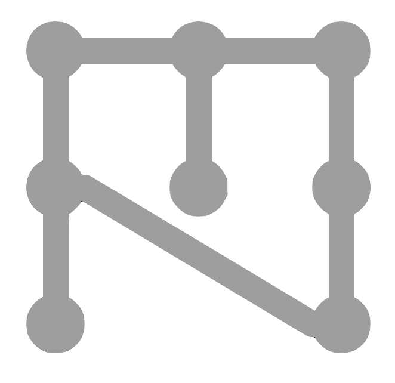

About `ezmsg` Architecture
#############################

.. dd:ezmsg-graph:start

|ezmsg_logo_small| Overview
*****************************

`ezmsg` is a Python framework that runs a stream-processing system as a graph of asynchronous components connected by typed publish/subscribe streams.

The building block is the **Unit**: a class that declares its input and output streams, optional settings (configuration, chosen at construction and, if the Unit accepts it, changed while the system runs) and state, and ``async`` methods that run each time a message arrives on an input stream (``@ez.subscriber``) or that publish to an output stream (``@ez.publisher``). A **Collection** groups Units and other Collections behind streams of its own, so a sub-pipeline can be reused as a single component. One output stream can feed any number of inputs and one input can listen to any number of outputs, so the graph is not limited to a linear chain; it must, however, be acyclic.

A system is declared in plain Python: instantiate the components, list the connections as (output stream, input stream) pairs, and pass both to ``ez.run()``. `ezmsg` places the components in one or more operating-system processes (a Collection's ``process_components()`` chooses which components get their own process), runs each Unit's methods as coroutines on an asyncio event loop, and keeps running until the components finish or the system is interrupted.

A **GraphServer** coordinates the running system. It is a small TCP service, started by ``ez.run()`` when none is already reachable, that holds the graph of topics and connections, tells each subscriber which publishers to listen to (and updates it when the graph changes), creates the shared-memory segments used between processes, and relays settings changes and profiling data. Because the graph lives in the GraphServer rather than inside one script, other processes, including the ``ezmsg`` command-line tools and `ezmsg-dashboard`, can attach to a running system to inspect or modify it.

.. mermaid::
   :alt: Three ezmsg Units: a source and a filter in one process, a decoder in a second process on the same host, and a viewer on another host. The filter output feeds both the decoder over shared memory and the viewer over TCP; the source-to-filter edge is in-process. Every process is registered with one GraphServer.
   :caption: An ezmsg graph spanning two processes on one host and a process on a second host. Each edge uses the cheapest transport its endpoints allow; the GraphServer tracks the graph but does not carry the data.

   flowchart LR
     GS[("GraphServer")]
     subgraph HOST1["Host A"]
       subgraph P1["Process 1"]
         SRC["Source unit"] -->|"in-process (by reference)"| FILT["Filter unit"]
       end
       subgraph P2["Process 2"]
         DEC["Decoder unit"]
       end
     end
     subgraph HOST2["Host B"]
       subgraph P3["Process 3"]
         VIEW["Viewer unit"]
       end
     end
     FILT -->|"shared memory"| DEC
     FILT -->|"TCP"| VIEW
     GS -.- P1
     GS -.- P2
     GS -.- P3

.. dd:ezmsg-graph:end

|ezmsg_logo_small| Modular Design
**********************************************

`ezmsg` is built around a modular design philosophy, where individual components (called `Unit`\ s) can be developed, tested, and reused independently. This modularity allows users to easily assemble and rearrange complex processing pipelines by connecting different `Unit`\ s together.

To showcase both the simplicity and modularity of `ezmsg`, I will explain how to build a simple signal processing pipeline in two steps: 

1. creation of the individual `Unit`\ s
2. creation of the pipeline by connecting the `Unit`\ s together

Step 1: Creation of the individual `Unit`\ s
=============================================

The design details of `Unit`\ s are explained in more detail in :ref:`unit_details`, but we show the structure here. 

.. code-block:: python

   class MyUnitSettings(ez.Settings):
       # optional dataclass containing configuration parameters for the Unit

   @dataclass
   class MyUnitState:
       # optional dataclass containing state variables for the Unit

   class MyUnit(ez.Unit):
       INPUT = ez.InputStream(InputMessageType)
       OUPUT = ez.OutputStream(OutputMessageType)

       SETTINGS = MyUnitSettings
       STATE = MyUnitState

       @relevant_decorator
       def method(self, msg: InputMessageType) -> OutputMessageType:
           # processing logic here

What we have done is:

- an optional settings dataclass containing configuration parameters for the `Unit`
- an optional state dataclass containing state variables for the `Unit`
- the actual `Unit` is a class inheriting from ``ez.Unit`` containing:
   - at least one input or output stream (here we have one of each)
   - optional ``SETTINGS`` and ``STATE`` attributes referencing the relevant dataclasses
   - one or more methods decorated with relevant decorators to define the processing logic of the `Unit`

An example can be found in the :doc:`tutorial <../tutorials/pipeline>`.

Step 2: Creation of the pipeline by connecting the `Unit`\ s together
===============================================================================

Once we have created the individual `Unit`\ s, we can connect them together to form a pipeline. We first define the nodes of our graph in terms of our `Unit`\ s, and then we define the connections between the nodes:

.. code-block:: python
    
    components = {
        "COUNT": Count(settings=CountSettings(iterations=10)),
        "ADD_ONE": AddOne(),
        "PRINT": PrintValue()
    }
    connections = (
        (components["COUNT"].OUTPUT_COUNT, components["ADD_ONE"].INPUT_COUNT),
        (components["ADD_ONE"].OUTPUT_PLUS_ONE, components["PRINT"].INPUT)
    )
    ez.run(components = components, connections = connections)

What we have done is:

- created a dictionary of components, where the keys are the names of the components and the values are instances of the `Unit`\ s (in this case, `Count`, `AddOne` and `PrintValue`)
- created a tuple of connections, where each connection is a tuple of the output stream of one component and the input stream of another component
- called ``ez.run()`` with the components and connections to start the pipeline

|ezmsg_logo_small| Backend Implementation
******************************************

.. include diagram of architecture here

.. maybe include detailed process order diagram here

GraphServer
======================

When an `ezmsg` pipeline is started, `ezmsg` initializes a GraphServer, which does two main things:

- spins up a process that keeps track of the graph state during execution. One GraphServer should be initialized per ezmsg pipeline. 
- spins up a process that initialises a Shared Memory Server using Python's `multiprocessing.shared_memory` module and allocates blocks of memory to nodes of the pipeline graph. This is used for efficient inter-process message communication. 

Pub/Sub Design
=======================

When a pipeline is initialised `ezmsg` constructs a directed acyclic graph (DAG) of the nodes (usually `Unit`\ s) in the pipeline. Each `Unit` can have one or more input and output streams, which are used to receive and send messages respectively. `ezmsg` handles these input and output streams as instances of the `Subscriber` and `Publisher` classes. 

`Publisher` and `Subscriber` instances are created with a publisher/subscriber design architecture in mind. Each `Publisher` has a list of `Subscriber`\ s it can simultaneously publish to. Similarly, each `Subscriber` has a list of `Publisher`\ s it is listening to. This kind of architecture allows pipelines that are not simply a linear chain of nodes. 

Messaging between `Publisher`\ s and `Subscriber`\ s is facilitated by the `ezmsg GraphServer` through the use of an appropriate messaging protocol identified at initialisation. `Publisher`\ s and `Subscriber`\ s in the same process use local memory cache. Inter-process communication is managed by the shared memory process and otherwise communication is done via TCP.

.. dd:ezmsg-transport:start

Transport, backpressure and zero-copy delivery
==============================================

`ezmsg` chooses a transport separately for each pair of publisher and subscribing process, when that process first connects to the publisher. The subscribing process tries to attach the publisher's shared-memory segment by name, and the result decides the route:

- **Same process**: the publisher hands the subscriber the object itself, by reference. Nothing is serialised or copied.
- **Different process, shared memory attached** (in practice, the same host): the publisher serialises the message once (pickle protocol 5, so large array buffers are written without an extra copy) into a ring of shared-memory buffers, and sends the subscribing process only a short notification naming the buffer.
- **Shared memory not attached** (in practice, a different host): the serialised message is sent over the TCP connection between the two processes.

The choice therefore follows from where the processes run, not from any configuration, and the same graph runs unchanged whether its components share a process, a machine or a network. TCP can also be forced, for one publisher or, with the ``EZMSG_FORCE_TCP`` environment variable, for every publisher in a process; this disables the by-reference path too. Within a receiving process, a message is deserialised once and shared by every subscriber in that process.

Each publisher owns a fixed ring of message buffers (32 by default), whatever the transport. A buffer is reused only after every subscriber has finished with the message in it, so when a consumer falls behind by a full ring, the publisher's next publish waits for it (**backpressure**) instead of overwriting or discarding data, and the publisher logs a warning. The wait propagates upstream: a Unit blocked on publishing stops consuming its own inputs. This is the default for every stream. A subscriber that should never slow its source, such as a live display, can declare its input stream ``leaky``: it then receives a private copy of each message, releases the buffer at once, and when its queue is full (``max_queue`` messages, one by default) it drops the oldest queued message, so that subscriber sees gaps but the publisher never waits for it.

Ordinary (non-leaky) subscribers receive messages **zero-copy**: the object passed to the subscriber method is the publisher's object, or a view of the shared-memory buffer, or the one deserialised copy shared within the process. Subscribers must therefore treat incoming messages as read-only, and copy any data they intend to modify or republish.

The connection handshake, the per-process message cache and the failure modes of mutating a shared message are described in :doc:`transport-messaging-internals`.

.. dd:ezmsg-transport:end

|ezmsg_logo_small| Command Line Interface
*******************************************

The `ezmsg` command line interface exposes extra tools to manage a pipeline that is running in the background on a machine. Run 

.. code-block:: python

    ezmsg -h 

to see all the available options.

Currently, one can use the CLI to:

- start a pipeline in the background (``ezmsg serve --address <host>:<port>``)
- start a pipeline in the foreground (``ezmsg start --address <host>:<port>``)
- shutdown a pipeline that is running (``ezmsg shutdown --address <host>:<port>``)
- visualise a pipeline that is running (``ezmsg mermaid --address <host>:<port>`` or ``ezmsg graphviz --address <host>:<port>``)

.. _unit_details: 

|ezmsg_logo_small| Basic ezmsg building blocks
***********************************************

Basic building block in `ezmsg` is a `Unit`, which represents a discrete processing element within a pipeline. Users can create custom Units by subclassing the base Unit class and implementing the required processing logic. One can combine multiple `Unit`\ s to form a `Collection`, which functions much like a `Unit` does (one may want to abstract away complexity by having a `Collection` representing a logical grouping of `Unit`\ s). The following discussion applies as much to `Collection`\ s as it does to `Unit`\ s, so we will just refer to `Unit`\ s for simplicity.

A `Unit` typically contains the following attributes/components:

- ``SETTINGS``: Configuration parameters that define the behavior of the `Unit`. These can be set during initialization or modified at runtime - though they are usually chosen for the lifetime of the `Unit`. 
- ``STATE``: Internal state variables that maintain the current status of the `Unit`. These can be updated during processing to reflect changes in the `Unit`\ s operation. Unlike the parameters in ``SETTINGS``, these are expected to change frequently during the lifetime of the `Unit`.
- input and output streams: Data channels through which the `Unit` receives input and sends output. These streams facilitate communication between different `Unit`\ s in a pipeline.
- processing methods: Functions that define the core processing logic of the `Unit`. These methods can be decorated to be invoked when data is received on the input streams, and produce output that is sent to the output streams.

SETTINGS
=========================

This attribute is to be declared in the `Unit` in the format:

.. code-block:: python

   SETTINGS = RelevantSettingsClass

The capitalization is important as ezmsg reserves this attribute name for this purpose and this is critical for the backend implementation of the `Unit`. Notice that we do not instantiate the settings class here, we just provide a reference to the class. ezmsg will take care of instantiating the settings class when the pipeline is created or in some cases when it receives the first message. There must be at most one such attribute in a `Unit` or `Collection`.

STATE
=========================

This attribute is to be declared in the `Unit` in the format:

.. code-block:: python

   STATE = RelevantStateClass

As with ``SETTINGS``, the capitalization here is important as ezmsg reserves this attribute name for this purpose and this is critical for the backend implementation of the `Unit`. Notice that we do not instantiate the state class here, we just provide a reference to the class. ezmsg will take care of instantiating the state class when the pipeline is created or in some cases when it receives the first message. There must be at most one such attribute in a `Unit` or `Collection`.

streams
=========================

A unit must have at least one input or output stream. Streams are defined as class attributes in the `Unit` in the format:

.. code-block:: python

   INPUT = ez.InputStream(MessageInType)
   OUTPUT = ez.OutputStream(MessageOutType)

.. note:: ``ez`` here refers to the typical import alias for ezmsg, i.e. ``import ezmsg.core as ez``

Unlike with ``SETTINGS`` and ``STATE``, the capitalization of the stream names and the names in fact are not reserved, though we recommend using something understandable. One can have as many input and output streams as needed in a `Unit` or `Collection`. The message types can be any type, and for signal processing purposes, we recommend our own implemented message type :doc:`AxisArray <axisarray>`.

.. _decorators:

`Unit` methods
=========================

Typically, a `Unit` will have one or more methods that define its processing logic. There are a few in-built decorators that can be used to configure the behaviour of these methods. In particular, we use specific decorators to connect the method to a `Publisher` and `Subscriber` (defined as output and input streams in the `Unit` body). We can also provide configuration options defining in which process this method should sit. 

These are the available decorators and their function:

.. list-table::
   :widths: 20 40 40
   :header-rows: 1 
   :class: front_page_table

   * - Decorator
     - Description
     - Usage
   * - ``@ez.subscriber``
     - This decorator is used to indicate that a method should be invoked when data is received on a specific input stream. The decorated method should take in the message as an argument.
     - .. code-block:: python
   
            @ez.subscriber('INPUT')
            def process(self, msg: MessageInType) -> None:
               # processing logic here
   * - ``@ez.publisher``
     - This decorator is used to indicate that a method should publish messages to a specific output stream. The decorated method should produce the message to be sent.
     - .. code-block:: python

            @ez.publisher('OUTPUT')
            def generate(self) -> MessageOutType:
               # message generation logic here
               return message
   * - ``@ez.main``
     - This decorator is used to indicate that a method should run in the main process of the `Unit`. This is useful for methods that need to perform tasks that are not directly related to message processing, such as initialization or cleanup.
     - .. code-block:: python

         @ez.main
         def initialize(self) -> None:
            # initialization logic here
   * - ``@ez.task``
     - This decorator is used to indicate that a method should run in a separate task process. This is useful for methods that perform long-running or blocking operations, allowing the `Unit` to continue processing other messages.
     - .. code-block:: python

            @ez.task
            def long_running_task(self) -> None:
            # long-running task logic here
   * - ``@ez.process``
     - This decorator is used to indicate that a method should run in its own separate process. This is useful for methods that require isolation from the main process, such as CPU-intensive tasks or operations that may crash.
     - .. code-block:: python

            @ez.process
            def cpu_intensive_task(self) -> None:
            # CPU-intensive task logic here
   * - ``@ez.timeit``
     - This decorator is used to measure the execution time of a method. It can be useful for performance monitoring and optimization.
     - .. code-block:: python

            @ez.timeit
            def monitored_method(self) -> None:
            # method logic here

.. note:: The decorators ``@ez.subscriber`` and ``@ez.publisher`` can be used together on the same method if the method both processes incoming messages and produces outgoing messages.

|ezmsg_logo_small| AxisArray
*********************************

Our preferred Message format is `AxisArray`. See :doc:`axisarray` for more information.

|ezmsg_logo_small| See Also
********************************

#. :doc:`axisarray`
#. :doc:`../tutorials/start`
#. :doc:`../how-tos/basics/content-basics`
#. :doc:`../how-tos/pipeline/content-pipeline`

